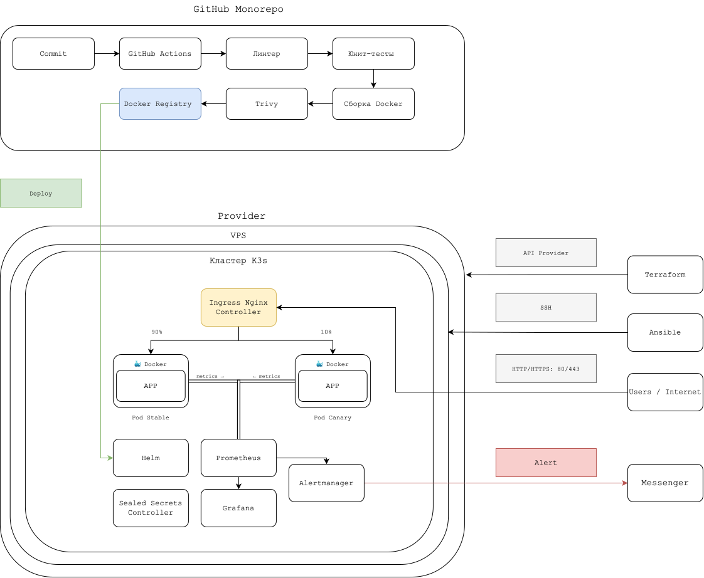

# Future Telecom — Materials Microservice & Cloud Infrastructure

## Описание проблемы

В современных распределенных телекоммуникационных платформах и учебных сервисах часто возникает задача динамической интеграции с внешними облачными хранилищами (публичными каталогами Яндекс Диска) для отдачи учебных материалов и документации. Ручное управление ссылками, отсутствие валидации входных данных, задержки при обновлении контента, а также отсутствие автоматизированной инфраструктуры, мониторинга и проверки безопасности приводят к невысокой надежности системы и сложностям при масштабировании.

## Цель работы

Создание отказоустойчивой, прозрачной и полностью автоматизированной платформы:

1. Разработка асинхронного REST API микросервиса на FastAPI для работы с публичными ресурсами Яндекс Диска, со строгой валидацией Pydantic и экспортом метрик.
2. Автоматическое развёртывание облачной инфраструктуры в OpenStack / Selectel через Terraform и конфигурация узла через Ansible.
3. Развёртывание и оркестрация Kubernetes-кластера (k3s) с Ingress-контроллером, Sealed Secrets, системой мониторинга Prometheus/Grafana и автоматизированным CI/CD пайплайном (GitHub Actions, Trivy).

## Состав команды

* **Валерий Михайлов (Backend Developer):**  
  - Роль: Разработка серверной логики и API сервиса.  
  - Навыки и задачи: Python 3.11+, FastAPI, Pydantic v2, httpx, pytest, uv. Разработка асинхронного REST API (materials-univ-api), написание юнит-тестов с моками, Pydantic-валидация, оптимизация работы с Яндекс Диск API и настройка линтинга.

* **Егор Луконин (Network engineer):**  
  - Роль: Специалист по сетевым технологиям.  
  - Навыки и задачи: Terraform, CI/CD, написание playbooks Ansible, разработка инфраструктуры проекта, настройка Ingress-контроллера, развертывание мониторинга (Grafana, Prometheus), настройка Sealed Secrets, работа с облаком (Selectel).

* **Алина Корниенко (Project manager):**  
  - Роль: Менеджер проекта.  
  - Навыки и задачи: Работа с таск-менеджерами, декомпозиция и трекинг задач, визуализация концептов и отчетность, создание презентаций для защиты и демонстрации результатов проекта, ведение учета выполнения задач и контроль сроков, продуктовая коммуникация.

* **Владислав Галеев (Data Scientist):**  
  - Роль: Аналитик данных.  
  - Навыки и задачи: Python 3.11+, pytest, numpy, jupyter, notebook, Git, matplotlib, qiskit, Ansible, CI/CD, Trivy, Linters (flake8, black), SLI/SLO/SLA. Настраивал Trivy, определял SLI/SLO/SLA метрики для мониторинга.

* **Георгий Винокуров (DevOps):**  
  - Роль: Специалист по разработке и эксплуатации.  
  - Навыки и задачи: Docker, k3s, Helm, Makefile, CI/CD. Создание Docker образа, Makefile, настройка k3s, написание Helm-chart.

## Архитектура / Схема



*Поток запросов: Пользователь → Traefik Ingress Controller → FastAPI Microservice (materials-univ-api) → Yandex Disk Public API.  
Кластер k3s: содержит микросервис, Ingress, систему мониторинга (Prometheus / Grafana) и оператор Sealed Secrets.  
Автоматизация: инфраструктура поднимается через Terraform и настраивается с помощью Ansible Playbooks. CI/CD пайплайн на базе GitHub Actions запускает линтеры, тесты и сканирование безопасности.*

## Использованные инструменты

| Категория | Инструменты и версии |
|-----------|---------------------|
| **Backend & API** | Python 3.12, FastAPI, Pydantic v2, Uvicorn, httpx, uv |
| **Тестирование и качество** | pytest, pytest-asyncio, black, flake8, yamllint |
| **Infrastructure as Code (IaC)** | Terraform ≥ 1.6, OpenStack / Selectel Provider, Ansible (community.general) |
| **Оркестрация и контейнеризация** | Kubernetes (k3s v1.28+), Docker / Buildx, Helm, ingress-nginx |
| **CI/CD & Безопасность** | GitHub Actions, Trivy 0.75 (IaC + image scan), Sealed Secrets, kubeseal |
| **Мониторинг & Аналитика** | Prometheus, Grafana, Alertmanager (kube-prometheus-stack 92.3.0), kube-prometheus-stack |
| **Управление секретами** | Sealed Secrets (Bitnami), kubeseal |
| **Другое** | Make, ssh/scp, ctr (containerd) |

## Как запустить

### Быстрый старт

```bash
git clone https://github.com/EgorLukonin/ballagan-future-telecom
cd ballagan-future-telecom
make up
```

В конце вывода появятся URL API и Grafana.

---

### Предварительные требования (управляющая машина)

- Linux/macOS с `make`, `ssh`, `scp`
- Terraform ≥ 1.6, Ansible + коллекция `community.general` (`ansible-galaxy collection install community.general`)
- Docker (для `build-image`), Helm, kubectl (для ролей apps — выполняются на localhost)
- Переменные окружения для Terraform:
  - `TF_VAR_selectel_username`
  - `TF_VAR_selectel_password`
  - `TF_VAR_selectel_account`
  - `TF_VAR_project_id`
  - `TF_VAR_selectel_ip_address`

Проверка: `make prereqs`

---

### Подготовка Sealed Secrets (обязательно перед первым `make up`)

Подробная инструкция: **[docs/sealed-secrets-setup.md](docs/sealed-secrets-setup.md)**

Краткий чек-лист файлов, которые должны появиться в `k3s/sealed-secrets/`:

| Файл | Назначение |
|------|------------|
| `master-key.yaml` | Мастер-ключ контроллера Sealed Secrets (получить с кластера) |
| `monitoring-sealed-secret.yaml` | Пароль админа Grafana (запечатать через kubeseal) |
| `alertmanager-telegram-sealed-secret.yaml` | Конфиг Alertmanager с токеном Telegram-бота (запечатать через kubeseal) |
| `materials-api-sealed-secret.yaml` | Уже в репо — секрет приложения (Яндекс.Диск) |

---

### Все команды make

Полный список: `make help` (цель по умолчанию).

| Цель | Что делает |
|---|---|
| `make help` | список всех команд с описаниями |
| `make up` | полное развёртывание: terraform → k3s → образы → приложения; в конце печатает URL API и Grafana |
| `make down` | terraform destroy + удаление локальных артефактов |
| `make prereqs` | проверка установленных инструментов (terraform, ansible, helm, kubectl, docker, ssh, scp) |
| `make inventory` | генерация `ansible/inventory.ini` из terraform output |
| `make ansible-infra` / `ansible-apps` | фазы ansible по отдельности (теги `infra` / `apps`) |
| `make tf-init` / `tf-plan` / `tf-apply` / `tf-destroy` | terraform по шагам |
| `make build-image` / `push-image` | сборка образа и доставка на ВМ (scp + `ctr images import`) |
| `make test` | unit-тесты pytest |
| `make lint` | black + flake8 + yamllint + ansible-lint (как в CI) |
| `make status` | terraform output + узлы и поды кластера |
| `make app-status` / `app-logs` | поды и логи приложения (primary/canary) |
| `make rollout` | перезапуск деплойментов приложения |
| `make verify` | сквозная проверка: `/health`, `/metrics` через ingress, узлы кластера |
| `make grafana` / `prometheus` / `alertmanager` | port-forward UI мониторинга на localhost |
| `make canary 50` | задать вес canary (%), по умолчанию 10 |
| `make clean` | удалить локальные артефакты без terraform destroy |

---

## Мониторинг и наблюдаемость

- В микросервис встроен Prometheus-экспортер метрик (`/metrics`).
- В кластере k3s развернут стек **kube-prometheus-stack** (Prometheus + Alertmanager + Grafana) версии `92.3.0`, ставится ролью `monitoring` на фазе `apps` (`make up`).
- Конфигурация в `k3s/monitoring/`:
  - `values.yaml` — урезано под ВМ 4 GB: Prometheus 1 реплика / retention 15d, отключены kubeEtcd/kubeControllerManager/kubeScheduler/kubeProxy
  - `servicemonitor.yaml` — сбор `/metrics` с primary/canary нашего API
  - `prometheusrule.yaml` — алерты: `UniversityMaterialsAPIDown` (critical), `UniversityMaterialsAPIHighErrorRate` (warning), burn-rate алерты для error budget
  - `grafana-dashboard-configmap.yaml` — дашборд «University Materials API» (RPS, 5xx, p95, up, error budget remaining)
  - `sli-rules.yaml` — recording-правила `sli:*` для SLI/SLO

### SLI / SLO (окно 15 дней)

| Показатель | SLO |
|---|---|
| Доступность (доля не-5xx) | ≥ 99.5% |
| Латентность | p95 ≤ 500 мс, p99 ≤ 1 с |
| Ошибки 5xx | < 1% |
| Аптайм | ≥ 99.9% |
| Успешные выдачи списка материалов | ≥ 99.9% |

Полный документ: [`docs/sli-sla.md`](docs/sli-sla.md).

### Доступ после развёртывания

| Что | Как открыть |
|---|---|
| Grafana | `http://<IP-сервера>/grafana`, логин `admin`, пароль из секрета |
| Prometheus UI | `kubectl --kubeconfig kubeconfig -n monitoring port-forward svc/kube-prometheus-stack-prometheus 9090:9090` → http://localhost:9090 |
| Alertmanager UI | `kubectl --kubeconfig kubeconfig -n monitoring port-forward svc/kube-prometheus-stack-alertmanager 9093:9093` → http://localhost:9093 |
| Дашборд API | Grafana → Dashboards → «University Materials API» |

Проверка метрик: в Prometheus UI выполните `up{job=~"default/materials-api/.*"}` — должно вернуть экземпляры primary и canary.

### Алертинг в Telegram

Алерты из Prometheus маршрутизируются в Alertmanager и уходят в Telegram-бот. Конфиг хранится в запечатанном секрете `alertmanager-telegram-secret`.

Алерты:
- `UniversityMaterialsAPIDown` (critical) — экземпляр не отвечает более 2 минут
- `UniversityMaterialsAPIHighErrorRate` (warning) — доля 5xx выше 5% в течение 5 минут
- Burn-rate алерты: `UniversityMaterialsAPIErrorBudgetBurnFast` (critical), `UniversityMaterialsAPIErrorBudgetBurnSlow` (warning)

Логика: группировка по `alertname`, `group_interval 5m`, повтор `repeat_interval 4h`; ингибирование алертов приложения пока нода недоступна.

---

## Безопасность

- **Trivy IaC scan** — сканирование конфигураций (terraform, ansible, helm, Dockerfile) на misconfig и секреты; падение на HIGH/CRITICAL; результаты в **GitHub → Security → Code scanning**.
- **Trivy image scan** — сканирование Docker-образа после сборки; падение на HIGH/CRITICAL; результаты в **Security → Code scanning**.
- **Sealed Secrets** — все конфиденциальные данные (пароль Grafana, токен Telegram-бота, секреты приложения) хранятся в git только в запечатанном виде. Мастер-ключ контроллера не в git.
- **Нет внешнего реестра** — образ доставляется на ВМ через scp и импортируется в containerd (`ctr images import`).
- **UFW на VM** — роль `base` настраивает firewall.
- **`.trivyignore`** — исключения для ложных срабатываний Trivy.
- **GitHub Actions secrets** — `DOCKERHUB_USERNAME`, `DOCKERHUB_TOKEN` для пуша образа.

---

## Использование LLM

*Раздел заготовлен. Описание использования LLM-инструментов (GitHub Copilot, ChatGPT, Claude и др.) для генерации кода, конфигураций, тестов, документации будет добавлено командой.*

---

## Troubleshooting

*Раздел заготовлен. Таблица типичных проблем и решений будет заполнена командой по итогам эксплуатации.*

---

## Лицензия

[MIT License](LICENSE)